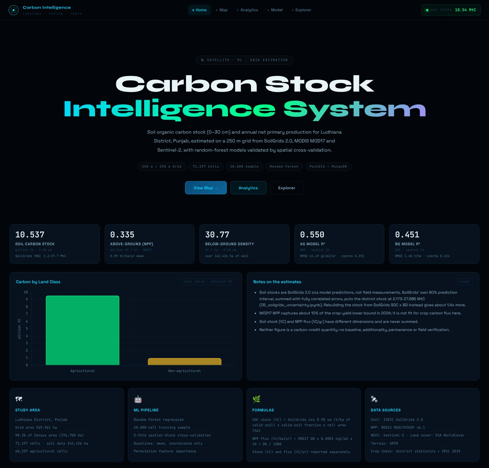
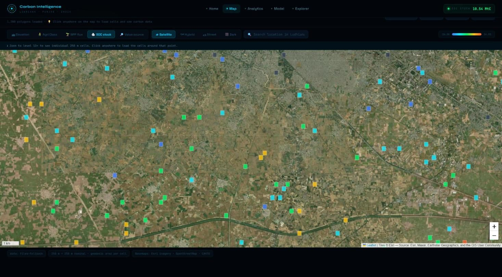
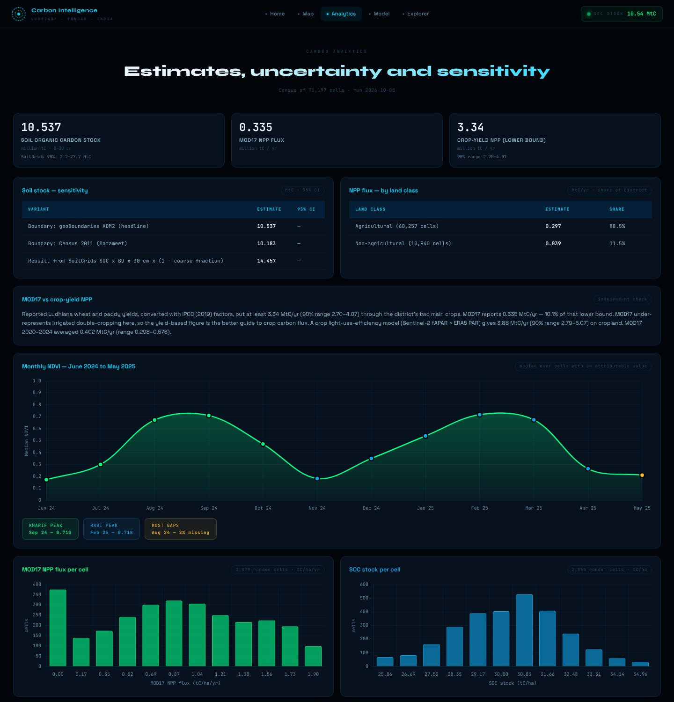
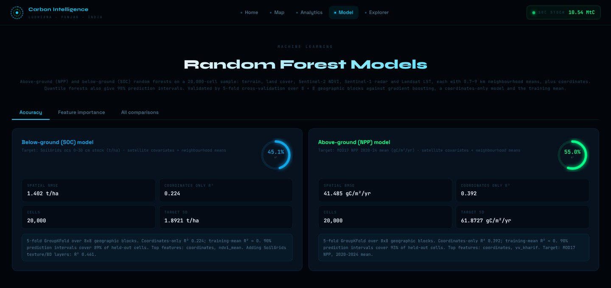

<div align="center">

# 🌾 Carbon Stock Estimation — Ludhiana, Punjab

**How much carbon do Ludhiana's soils hold, and how much do its crops fix each year?**

A 250 m satellite-and-soil census of the whole district, with machine learning, uncertainty analysis, and a dashboard.

[](https://carbon-stock-estimation-ludhiana.streamlit.app/)
[](project_report.md)
[](https://github.com/swathipatil-analytics/carbon-stock-estimation-ludhiana)




</div>

---

## 📊 Key Results

| Indicator                                | Result                           |
| ---------------------------------------- | -------------------------------- |
| **Soil organic carbon stock (0–30 cm)**  | **10.54 MtC**                    |
| Carbon dioxide equivalent                | 38.6 Mt CO₂e                     |
| Soil organic carbon density              | 30.8 tC/ha                       |
| SoilGrids' 90% uncertainty range         | 2.2–27.7 MtC                     |
| **Estimated crop carbon fixed per year** | **3.34–3.89 MtC/year**           |
| MODIS NPP estimate                       | 0.34 MtC/year                    |
| Random Forest spatial cross-validation   | R² 0.55 for NPP; R² 0.45 for SOC |
| Spatial grid                             | 71,197 cells at 250 m resolution |

> **Important distinction:** Soil carbon is a stock measured in tonnes, whereas annual crop carbon fixation is a flux measured in tonnes per year. These quantities are reported separately and must not be added together.

*The figures above reflect the project's current analysis and should be interpreted alongside the assumptions, validation results, and limitations documented in the project report.*

## 🔍 What Makes This Project Different?

* **District-wide spatial analysis:** Examines the district using a 250 m grid rather than relying only on a small sample of locations.
* **Spatial model validation:** Uses spatial cross-validation to reduce overly optimistic results caused by neighbouring observations appearing in both training and testing data.
* **Independent comparisons:** Compares productivity estimates from MODIS with crop-yield-based calculations and a crop light-use-efficiency approach.
* **Uncertainty analysis:** Examines SoilGrids quantiles, prediction intervals, and alternative district boundaries.
* **Integrated data workflow:** Connects Google Earth Engine, Python notebooks, spatial datasets, databases, APIs, and dashboard interfaces.

## 🛰️ Data Sources

The project uses geospatial, satellite, soil, climate, and agricultural information, including:

* **SoilGrids 2.0:** Soil organic carbon estimates and uncertainty quantiles.
* **MODIS MOD17A3HGF:** Annual net primary productivity.
* **Sentinel-2:** Vegetation indices and crop-related information.
* **Sentinel-1:** Radar-derived covariates.
* **Landsat 8/9:** Land surface temperature information.
* **ESA WorldCover:** Land-cover classification.
* **SRTM:** Elevation and terrain information.
* **ERA5-Land:** Climate and radiation-related variables.
* **District boundaries and agricultural statistics:** Spatial boundaries and crop-related information.

The availability and temporal coverage of each source depend on the dataset and processing workflow.

## 🖥️ Dashboard

The dashboard provides interfaces for exploring the project's results.

| Map                                                                  | Analytics                                                                        | Model                                                                    |
| -------------------------------------------------------------------- | -------------------------------------------------------------------------------- | ------------------------------------------------------------------------ |
|  |  |  |

Additional screenshots:

* [Home page](docs/screenshots/home.jpg)
* [Explorer page](docs/screenshots/explorer.jpg)

The dashboard is designed around five pages:

1. **Home:** Overview of the project and its key results.
2. **Map:** Spatial exploration of the grid cells.
3. **Analytics:** Summary statistics and visual analysis.
4. **Model:** Model performance and uncertainty information.
5. **Explorer:** Search and export functionality for exploring available records.

### Open the Dashboard

**Live application:** https://carbon-stock-estimation-ludhiana.streamlit.app/

The live application depends on the deployment being available and correctly configured.

## 🚀 Run the Project Locally

### Step 1: Open the project directory

Open CMD in the directory containing this README and the `requirements.txt` file.

### Step 2: Create a Python virtual environment

```bash
python -m venv .venv
```

### Step 3: Activate the virtual environment on Windows

```cmd
.venv\Scripts\activate
```

### Step 4: Install the development dependencies

```bash
pip install -r requirements-dev.txt
```

### Step 5: Run the available dashboard

For the Flask-based dashboard:

```cmd
IIRS\Carbon_Stocks\carbon_project\run_dashboard.bat
```

Alternatively, depending on the project's configuration, run the Streamlit dashboard:

```bash
streamlit run app/streamlit_app.py
```

The Flask dashboard and Streamlit application may use different configurations. Consult their respective documentation if additional environment variables or services are required.

### Step 6: Run the tests

```bash
pytest tests/
```

Some tests or workflows may require additional packages, data files, or external services.

## 📓 Analysis Notebooks

The notebooks under `IIRS/Scrpit/` represent the main analytical workflow.

| Notebook                         | Purpose                                                                                                |
| -------------------------------- | ------------------------------------------------------------------------------------------------------ |
| `00_gee_extraction.ipynb`        | Extracts soil, productivity, land-cover, terrain, and vegetation information from Google Earth Engine. |
| `01_data_quality.ipynb`          | Performs data-quality checks on the extracted datasets.                                                |
| `02_carbon_pipeline.ipynb`       | Calculates carbon estimates, uncertainty, crop comparisons, and machine-learning results.              |
| `03_publish_databases.ipynb`     | Publishes results to the configured databases and checks the resulting data.                           |
| `04_location_map.ipynb`          | Produces the location map.                                                                             |
| `05_soilgrids_uncertainty.ipynb` | Examines uncertainty in SoilGrids-based carbon stock estimates.                                        |
| `06_shc_validation.ipynb`        | Contains the Soil Health Card validation workflow and regression-kriging analysis.                     |
| `07_gee_extra_covariates.ipynb`  | Processes additional satellite and climate covariates.                                                 |

The Earth Engine extraction workflow requires appropriate Google Earth Engine access and configuration.

## 📁 Project Structure

```text
carbon-stock-estimation-ludhiana/
│
├── IIRS/
│   ├── Carbon_Stocks/
│   │   ├── boundaries/
│   │   │   ├── ludhiana_census2011_datameet.geojson
│   │   │   ├── ludhiana_geoboundaries_adm2.geojson
│   │   │   ├── punjab_districts_geoboundaries_adm2.geojson
│   │   │   └── punjab_state_geoboundaries_adm1.geojson
│   │   ├── carbon_project/
│   │   │   ├── backend/
│   │   │   └── frontend/
│   │   ├── results/
│   │   ├── soilgrids_quantiles/
│   │   └── v2/
│   │
│   └── Scrpit/
│       ├── 00_gee_extraction.ipynb
│       ├── 01_data_quality.ipynb
│       ├── 02_carbon_pipeline.ipynb
│       ├── 03_publish_databases.ipynb
│       ├── 04_location_map.ipynb
│       ├── 05_soilgrids_uncertainty.ipynb
│       ├── 06_shc_validation.ipynb
│       └── 07_gee_extra_covariates.ipynb
│
├── app/
│   └── streamlit_app.py
├── docs/
│   ├── screenshots/
│   └── DATA_DICTIONARY.md
├── tests/
├── config.py
├── estimators.py
├── main application and supporting files
├── requirements.txt
├── requirements-dev.txt
├── project_report.md
├── .env.example
├── .gitignore
└── LICENSE
```

## 🗄️ Database Configuration

The project includes workflows for using PostgreSQL/PostGIS and MongoDB.

If database-backed functionality is required:

1. Review `.env.example`.
2. Create a local `.env` file from the example.
3. Configure your own credentials and connection settings.
4. Follow the database setup instructions in the notebooks and application code.
5. Run the database publishing workflow when the required services are available.

**Security:** Never commit your real `.env` file, passwords, database credentials, or API keys to GitHub. Keep sensitive values out of notebooks and other committed files as well.

## ⚠️ Limitations

* The soil organic carbon estimates are based on SoilGrids and have not been independently verified against field samples within this project.
* Soil Health Card validation depends on obtaining and preparing the required field or laboratory data.
* MODIS productivity estimates may differ substantially from crop-specific estimates in irrigated agricultural landscapes.
* Machine-learning results depend on the input data, feature selection, spatial validation strategy, and model assumptions.
* Results depend on the spatial boundaries, grid definition, dataset coverage, and processing decisions.
* Uncertainty estimates should be considered when interpreting district-level carbon totals and model predictions.

Further discussion is available in [`project_report.md`](project_report.md).

## 🧪 Testing

The repository includes automated tests for the application's configuration, estimators, API, results, and related components.

Run the test suite with:

```bash
pytest tests/
```

The test results depend on the installed dependencies, test configuration, and availability of any required resources.

## 👥 Team

Group project associated with Big Data Analytics and the Indian Institute of Remote Sensing (IIRS–ISRO), Dehradun, as part of the M.Sc. Agriculture Analytics programme involving DAU, AAU, and IIRS–ISRO.

| Member               | Contribution / Profile                    |
| -------------------- | ----------------------------------------- |
| **Sathwik Ramaka**   | Model development, results, and dashboard |
| **Kadiri Yaswanthi** | Project contributor                       |
| **Himanshu Bhanja**  | Project contributor                       |
| **Swathi A Patil**   | Project contributor                       |

### Team Profiles

* [Sathwik Ramaka — LinkedIn](https://www.linkedin.com/in/sathwikramaka/)
* [Sathwik Ramaka — GitHub](https://github.com/sathwikramaka)
* [Kadiri Yaswanthi — LinkedIn](https://www.linkedin.com/in/kadiri-yaswanthi-9a632b204/)
* [Kadiri Yaswanthi — GitHub](https://github.com/YASWANTHI2410)
* [Himanshu Bhanja — LinkedIn](https://www.linkedin.com/in/himanshu-bhanja-70362a2bb/)
* [Swathi A Patil — LinkedIn](https://www.linkedin.com/in/swathi-a-patil-69462b3b1/)

---

## 📄 License

Refer to the [`LICENSE`](LICENSE) file for the project's licensing terms.

---

**Repository:** https://github.com/swathipatil-analytics/carbon-stock-estimation-ludhiana
